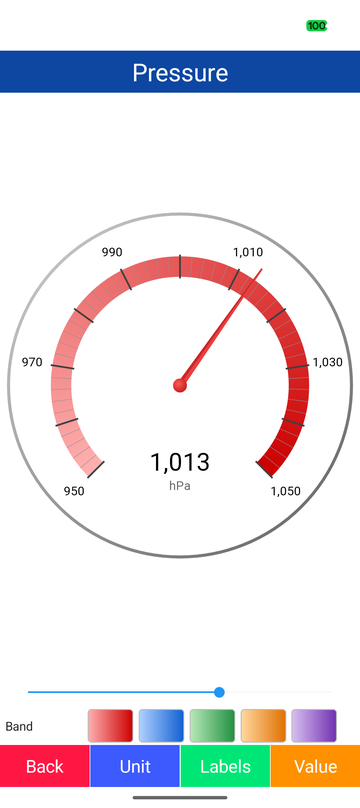
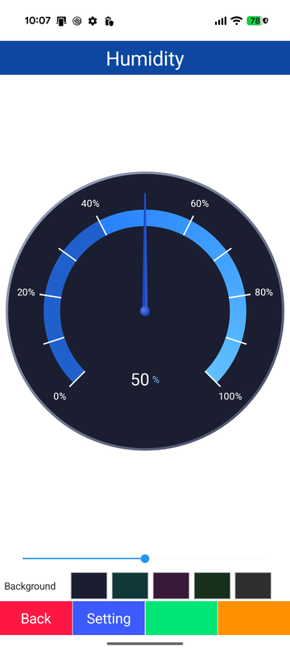
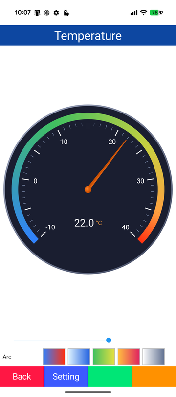
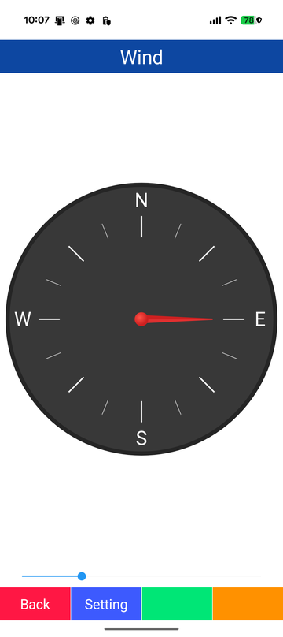
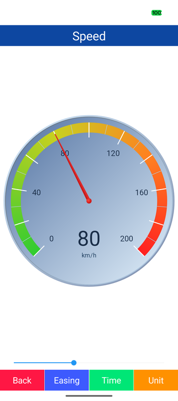
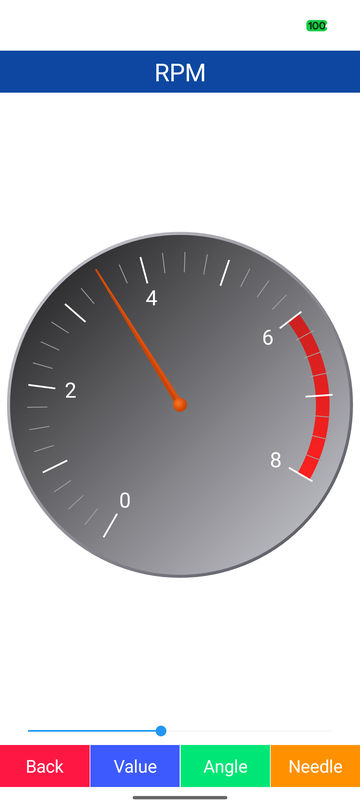

# ClamGauge - Circular gauge for .NET MAUI Android

[](https://www.nuget.org/packages/ClamGauge/)

## 🐚 What is this?

A .NET MAUI circular gauge for Android drawn with SkiaSharp on a single canvas.  
Face, bezels, arc, colored ranges, ticks, labels, center value and needle are all bindable properties, and the needle moves to a new value with an animation.  

| 🌈 Gradient band | 💧 Percent labels | 🎨 Colored ranges |
|:-:|:-:|:-:|
|  |  |  |

| 🧭 Compass labels | 🧩 Pattern in a style | 🏁 Turned scale and red zone |
|:-:|:-:|:-:|
|  |  |  |

## 🚀 Quick Start

Call `UseSkiaSharp()` when building the application.  

```csharp
var builder = MauiApp.CreateBuilder()
    .UseMauiApp<App>()
    .UseSkiaSharp();
```

Map `clr-namespace:ClamGauge;assembly=ClamGauge` to a prefix, give `ClamGaugeView` a size and bind `Value`.  
The dial is the largest circle that fits the view.  

```xml
<clam:ClamGaugeView HeightRequest="240"
                    Value="{Binding Speed}"
                    MinValue="0"
                    MaxValue="200"
                    MajorTickInterval="20"
                    MinorTickInterval="10"
                    LabelInterval="40"
                    ValueFormat="{}{0:N0}"
                    Unit="km/h">
    <clam:ClamGaugeView.Ranges>
        <clam:GaugeRange StartValue="0" EndValue="140" StartColor="#30CC30" EndColor="#C8D020" />
        <clam:GaugeRange StartValue="140" EndValue="200" StartColor="#FF8020" EndColor="#FF2020" />
    </clam:ClamGaugeView.Ranges>
</clam:ClamGaugeView>
```

```csharp
var compass = new ClamGaugeView
{
    MaxValue = 360,
    StartAngle = 0,
    SweepAngle = 360,
    LabelInterval = 90,
    ShowValue = false,
    LabelFormatter = static value => value switch { 0 => "N", 90 => "E", 180 => "S", 270 => "W", _ => String.Empty }
};
compass.Value = 135;
```

The first value is shown at once and later values move the needle over `AnimationDuration` milliseconds.  

## 🎨 Look

| Part | Properties |
|---|---|
| Face | `GaugeBackgroundColor`, and `GaugeBackgroundColor2` for a diagonal gradient |
| Bezels | `BezelOuterThickness` and `BezelInnerThickness` with their gradient colors |
| Arc | `ArcInnerExtent` / `ArcOuterExtent`, `ArcTrackColor`, `ArcStartColor` / `ArcEndColor`, or colored `Ranges` |
| Scale | Major and minor ticks, `LabelInterval`, `LabelFormat`, `LabelConverter`, `LabelFormatter` |
| Center value | `ShowValue`, `ValueFormat`, `Unit` on the right or below (`UnitPosition`), `ValueOffsetY` |
| Needle | Length, widths and two side colors, pivot, `AnimationDuration`, `AnimationEasing` |

Angles are degrees clockwise from 12 o'clock and extents are fractions of the radius inside the bezels.  
Thicknesses, widths, the pivot radius and font sizes are DIP.  

A style can hold a whole pattern, ranges included.  

```xml
<Style x:Key="SpeedGauge"
       TargetType="clam:ClamGaugeView">
    <Setter Property="MaxValue" Value="200" />
    <Setter Property="GaugeBackgroundColor" Value="#5070A0" />
    <Setter Property="GaugeBackgroundColor2" Value="#E4F2FC" />
    <Setter Property="Unit" Value="km/h" />
    <Setter Property="Ranges">
        <Setter.Value>
            <x:Array Type="{x:Type clam:GaugeRange}">
                <clam:GaugeRange StartValue="0" EndValue="140" StartColor="#30CC30" EndColor="#C8D020" />
                <clam:GaugeRange StartValue="140" EndValue="200" StartColor="#FF8020" EndColor="#FF2020" />
            </x:Array>
        </Setter.Value>
    </Setter>
</Style>
```

## 🔗 Binding and MVVM

Every property except `LabelFormatter` is a bindable property.  
`Ranges` takes a list from a binding or a style setter, and a list that implements `INotifyCollectionChanged` redraws the gauge when it changes.  
`Example/Modules/Gauge` contains a screen for each of six gauge patterns.  

```csharp
public sealed class WeatherViewModel : ObservableObject
{
    public double Pressure
    {
        get;
        set
        {
            field = value;
            OnPropertyChanged();
        }
    } = 1013;

    public IReadOnlyList<GaugeRange> PressureRanges { get; } =
    [
        new() { StartValue = 950, EndValue = 1050, StartColor = Color.FromArgb("#FFB0B0"), EndColor = Color.FromArgb("#CC0000") }
    ];
}
```

```xml
<clam:ClamGaugeView Value="{Binding Pressure}"
                    MinValue="950"
                    MaxValue="1050"
                    Ranges="{Binding PressureRanges}"
                    ValueFormat="{}{0:N0}"
                    Unit="hPa" />
```

## ✅ Supported features

| Category | Detail |
|---|---|
| **Scale** | Any value range, start angle and sweep up to a full circle, major and minor ticks, labels by format, converter or delegate |
| **Arc** | Track, gradient fill over the sweep, colored ranges with their own gradients |
| **Face** | Solid or gradient background, outer and inner gradient bezels |
| **Value** | Center value with a format, unit on the right or below, vertical offset |
| **Needle** | Tapered two-tone needle, round pivot, animation with a duration and an easing |

## 📖 API

See the [API reference](Document/API.md).  
